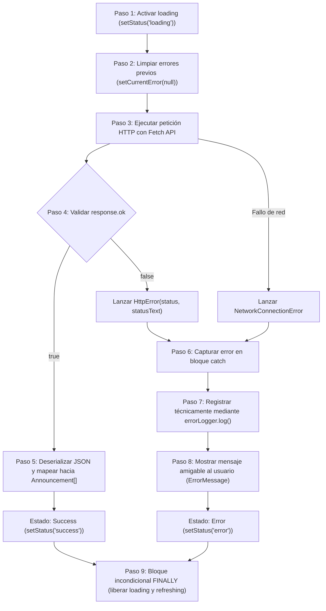

# CampusConnect 🎓📱

Aplicación móvil institucional desarrollada con **React Native**, **Expo Go**, **TypeScript** y **Expo Router** para la consulta, gestión y visualización de avisos y comunicados académicos en dispositivos móviles.

---

## 1. Descripción del Proyecto

**CampusConnect** es un portal móvil para la comunidad universitaria que centraliza:
- Comunicados oficiales e institucionales.
- Avisos de matriculación y registro académico.
- Fechas límite del calendario institucional.
- Eventos de facultades y proyectos de investigación.

El proyecto está diseñado con una arquitectura modular y limpia, empleando tipado estricto con TypeScript, componentes nativos y un flujo robusto de gestión de excepciones de red.

---

## 2. Objetivo Académico

- **Asignatura:** Aplicaciones Móviles Híbridas.
- **Tema:** 4.3 Manejo de errores y estrategias de crash reporting.
- **Propósito:** Demostrar cómo interceptar, clasificar y gestionar fallos en aplicaciones móviles sin comprometer la experiencia de usuario y sin perder la trazabilidad técnica necesaria para el diagnóstico de ingeniería.

### Requisitos Académicos Cumplidos:
1. **Identificación de operaciones susceptibles a fallo:** Peticiones de red HTTP asíncronas con Fetch API.
2. **Implementación del patrón `try / catch / finally`:** Flujo estricto en 9 pasos con liberación incondicional de estados.
3. **Mensajes comprensibles al usuario:** Traducción de errores a mensajes claros y empáticos sin exponer excepciones crudas.
4. **Registro técnico seguro (Privacy-First):** Auditoría técnica con ID único, marcas de tiempo y contexto, sanitizando credenciales y evitando almacenar información personal (PII).
5. **Provocación de fallo controlado:** Simulación de error contra un endpoint de laboratorio que responde con `HTTP 404 Not Found`.
6. **Recuperación exitosa:** Restablecimiento del estado con `HTTP 200 OK` y limpieza de mensajes de error.
7. **Diferenciación conceptual:** Explicación formal entre *Error Logging local* y *Crash Reporting remoto*.

---

## 3. Tecnologías Utilizadas

| Categoría | Tecnología | Versión | Propósito |
| :--- | :--- | :--- | :--- |
| **Framework Móvil** | [React Native](https://reactnative.dev/) | `0.88.1` | Renderizado nativo multiplataforma |
| **Plataforma / Runtime** | [Expo SDK](https://expo.dev/) | `~58.0.25` | Herramientas de compilación y ejecución |
| **Enrutamiento** | [Expo Router](https://docs.expo.dev/router/introduction/) | `~58.0.31` | Enrutamiento declarativo basado en archivos |
| **Lenguaje** | [TypeScript](https://www.typescriptlang.org/) | `~6.0.3` | Tipado estático y modelos formales |
| **Peticiones HTTP** | Fetch API + AbortController | Estándar W3C | Cliente HTTP con control de timeouts |
| **Testing** | Node.js Test Runner + tsx | v22.15.0 | Pruebas unitarias de red y lógica |
| **Control de Versiones** | Git + GitHub | v2.49.0 | Versionado distribuido |

---

## 4. Requisitos de Instalación

- **Node.js:** Versión `20.x` o superior (Recomendado: `v22.15.0 LTS`).
- **npm:** Versión `10.x` o superior (Recomendado: `11.16.0`).
- **Git:** Instalado en el sistema operativo.
- **Dispositivo Móvil:** Teléfono físico Android o iOS con la aplicación **Expo Go** instalada (disponible gratuitamente en Google Play Store y Apple App Store).

---

## 5. Instrucciones para Ejecutar con Expo Go

### 5.1. Clonar e Instalar Dependencias
```bash
# 1. Clonar el repositorio
git clone https://github.com/SparkRGT/CampusConnect.git

# 2. Acceder al directorio
cd CampusConnect

# 3. Instalar las dependencias (si es una clonación limpia)
npm install
```

### 5.2. Iniciar el Servidor de Desarrollo
```bash
npx expo start
```
1. La consola mostrará el código QR interactivo de Metro Bundler.
2. Abre la app **Expo Go** en tu dispositivo móvil:
   - **En Android:** Presiona *"Scan QR code"* y escanea el código en pantalla.
   - **En iOS:** Abre la app *Cámara* nativa, enfoca el código QR y toca la notificación de Expo Go.
3. La aplicación compilará los paquetes JavaScript y abrirá la pantalla principal de CampusConnect.

### 5.3. Solución ante Problemas de Red Local (Modo Túnel)
Si tu computadora y tu teléfono móvil se encuentran en redes WiFi separadas, o el router tiene activado el aislamiento de clientes (*AP Isolation*), utiliza el modo túnel:
```bash
npx expo start --tunnel
```
> **Nota:** Requiere el paquete `@expo/ngrok` (Expo te preguntará si deseas instalarlo automáticamente la primera vez). Este modo crea una URL pública segura que salta cualquier restricción de firewall local.

---

## 6. Estructura del Proyecto

```text
CampusConnect/
├── app/
│   ├── _layout.tsx                  # Layout raíz: Stack navigator, StatusBar y SafeAreaProvider
│   └── index.tsx                    # Pantalla principal: Header, controles, lista de avisos y visor de auditoría
│
├── src/
│   ├── components/
│   │   ├── AnnouncementCard.tsx     # Tarjeta estilizada con badge, categoría, título, cuerpo y fecha
│   │   ├── ErrorMessage.tsx         # Mensaje amigable, botón Reintentar y detalle técnico opcional
│   │   ├── LoadingIndicator.tsx     # Indicador de carga accesible con ActivityIndicator
│   │   └── index.ts                 # Exportaciones centralizadas de componentes
│   │
│   ├── constants/
│   │   └── api.ts                   # Centralización de URLs base, endpoints, timeouts y cabeceras
│   │
│   ├── models/
│   │   └── announcement.model.ts    # Contratos TypeScript: RawPost, Announcement, AppErrorType, ErrorLogEntry
│   │
│   └── services/
│       ├── announcements.service.ts # Consultas Fetch API, validación response.ok y taxonomía de errores
│       ├── error-logger.service.ts  # Error Logging local, sanitización de datos (Privacy First)
│       └── index.ts                 # Exportación de servicios
│
├── tests/
│   └── campusconnect.test.ts        # Suite de 8 pruebas unitarias (HTTP 200, 404, timeouts, sanitización)
│
├── assets/                          # Iconos, splash screen y recursos gráficos
├── app.json                         # Configuración oficial de la aplicación Expo
├── package.json                     # Scripts y dependencias
├── tsconfig.json                    # Configuración estricta de TypeScript con alias @/*
└── README.md                        # Documentación técnica completa
```

---

## 7. Funcionamiento de la API

La aplicación consume la API REST pública de pruebas **JSONPlaceholder**:
- **URL Base:** `https://jsonplaceholder.typicode.com`
- **Endpoint Válido:** `/posts` (Devuelve una colección de 100 posts con `id`, `title`, `body`).
- **Endpoint de Laboratorio:** `/endpoint-inexistente` (Devuelve un estado HTTP 404 Not Found).

### Transformación de Datos
El servicio `announcements.service.ts` mapea la respuesta sin procesar (`RawPost`) a un modelo institucional (`Announcement`):
- `id` ➔ Número de aviso oficial.
- `title` ➔ Título del comunicado con capitalización.
- `body` ➔ Descripción y contenido del aviso.
- `category` ➔ Clasificación automática: *Académico*, *Institucional*, *Evento* o *Fechas Importantes*.
- `formattedDate` ➔ Fecha representativa para la comunidad estudiantil.

---

## 8. Flujo Obligatorio de Manejo de Errores (`try / catch / finally`)

La aplicación implementa de forma rigurosa los **9 pasos** especificados:



### Taxonomía de Excepciones:
- **`HttpError`:** Provocado cuando el servidor responde con códigos 4xx o 5xx (ej: 404 Not Found, 500 Internal Error).
- **`NetworkConnectionError`:** Provocado ante caída de conexión, modo avión, error DNS o cuando se supera el tiempo límite configurado (`AbortController` a 10s).
- **`DataParsingError`:** Provocado si el cuerpo recibido no cumple la sintaxis JSON o no es un arreglo.

---

## 9. Error Logging Local vs Crash Reporting Remoto

En el desarrollo de software móvil moderno, es indispensable diferenciar ambas estrategias:

| Característica | Error Logging Local (`errorLogger`) | Crash Reporting Remoto (Sentry, Crashlytics, Datadog) |
| :--- | :--- | :--- |
| **Ubicación de almacenamiento** | Memoria volátil del dispositivo / Salida en consola de desarrollo. | Servidores externos en la nube con bases de datos especializadas. |
| **Impacto en Privacidad** | **Totalmente seguro.** Ningún dato sale del dispositivo del usuario. | **Requiere auditoría estricta.** Se deben filtrar IPs, nombres y datos PII antes del envío. |
| **Dependencia de red** | Funciona 100% offline y sin claves de API. | Requiere conectividad a internet para sincronizar las trazas y caídas. |
| **Casos de uso** | Depuración durante el desarrollo, trazabilidad académica y testing local. | Detección de fallos en producción masiva, dashboards en tiempo real y alertas a ingenieros. |
| **Soporte de desofuscación** | Trazas locales en tiempo de ejecución. | Requiere subir mapas de código (*Source Maps*) para interpretar código minimizado. |

> **Compromiso ético:** `CampusConnect` implementa un filtro automático de sanitización mediante expresiones regulares que elimina cualquier aparición de contraseñas, tokens `Bearer`, correos electrónicos o números de tarjetas antes de persistir cualquier registro.

---

## 10. Demostración de Escenarios de Laboratorio

### ESCENARIO A: Fallo Controlado (HTTP 404)
1. Presiona el botón rojo: **`🧪 Escenario A: Fallo Controlado (HTTP 404)`**.
2. La app ejecuta `fetch('https://jsonplaceholder.typicode.com/endpoint-inexistente')`.
3. El servidor responde con `HTTP 404 Not Found`.
4. El servicio detecta `response.ok === false` y arroja `HttpError(404)`.
5. Se captura la excepción, se registra técnicamente en `errorLogger` y se emite la ficha en consola.
6. La pantalla oculta los avisos y muestra el componente `ErrorMessage` con un mensaje amigable:
   > *"El comunicado o aviso solicitado no fue encontrado en el servidor universitario (Error 404). Verifica el recurso o inténtalo más tarde."*
7. **Prueba de reintento con endpoint original:** Presiona **`🔄 Reintentar`** dentro de la tarjeta de error. La aplicación repetirá la consulta al mismo endpoint inexistente, comprobando que el error es real y reproducible.

### ESCENARIO B: Recuperación Exitosa (HTTP 200)
1. Presiona el botón azul: **`📥 Escenario B: Recuperación (HTTP 200)`**.
2. La app ejecuta `fetch('https://jsonplaceholder.typicode.com/posts')`.
3. El servidor responde con `HTTP 200 OK`.
4. Se procesan los comunicados y se limpia el estado de error.
5. La pantalla renderiza la lista de avisos con sus respectivas tarjetas, categorías y fechas actualizadas.
6. El indicador superior cambia a **`En línea • Sincronizado (200 OK)`**.

---

## 11. Pruebas Automatizadas

Se construyó una suite de pruebas automatizadas ejecutadas mediante el test runner nativo de Node.js y `tsx`:

```bash
npm test
```

### Resultados Reales de la Ejecución:
```text
TAP version 13
Subtest: CampusConnect — Suite de Pruebas de Manejo de Errores y Crash Reporting
    ok 1 - 1. Debe procesar correctamente una consulta exitosa (HTTP 200)
    ok 2 - 2. Debe detectar y lanzar HttpError ante una respuesta HTTP 404 (Fallo controlado)
    ok 3 - 3. Debe capturar fallos de red y lanzar NetworkConnectionError
    ok 4 - 4. Debe registrar errores técnicamente y sanitizar credenciales y datos personales
    ok 5 - 5. Debe garantizar la finalización del estado de carga en bloque finally ante éxito o error
    ok 6 - 6. Debe permitir la limpieza de errores y reiniciar el historial
    ok 7 - 7. Debe permitir recuperación mediante una nueva petición exitosa tras un fallo 404
    ok 8 - 8. Debe traducir errores técnicos a mensajes amigables y accesibles para el usuario
1..8
ok 1 - CampusConnect — Suite de Pruebas de Manejo de Errores y Crash Reporting
# tests 8
# suites 1
# pass 8
# fail 0
# duration_ms 641.682
```

---

## 12. Limitaciones del Proyecto

1. **Persistencia temporal en memoria:** Los registros de errores se almacenan en un buffer circular en memoria volátil de 50 elementos para mantener la solución ligera y 100% compatible con Expo Go sin librerías nativas pesadas.
2. **API Mock:** Al utilizar JSONPlaceholder, los títulos y descripciones de las publicaciones provienen de un servicio público genérico en inglés, los cuales son enriquecidos mediante categorías y fechas académicas calculadas en el frontend.
3. **Sin servicio remoto configurado:** Por diseño pedagógico explícito, la aplicación no envía telemetría a plataformas de terceros como Sentry o Crashlytics.

---

## 13. Repositorio Oficial en GitHub

- **URL:** [https://github.com/SparkRGT/CampusConnect.git](https://github.com/SparkRGT/CampusConnect.git)
- **Rama principal:** `main`
- **Desarrollado para:** Asignatura de Aplicaciones Móviles Híbridas.
